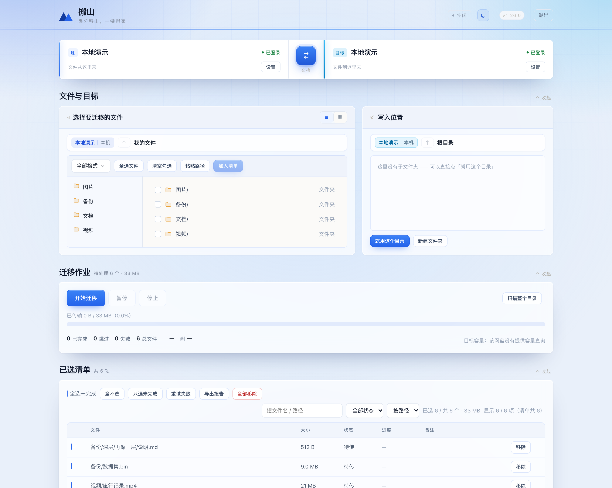
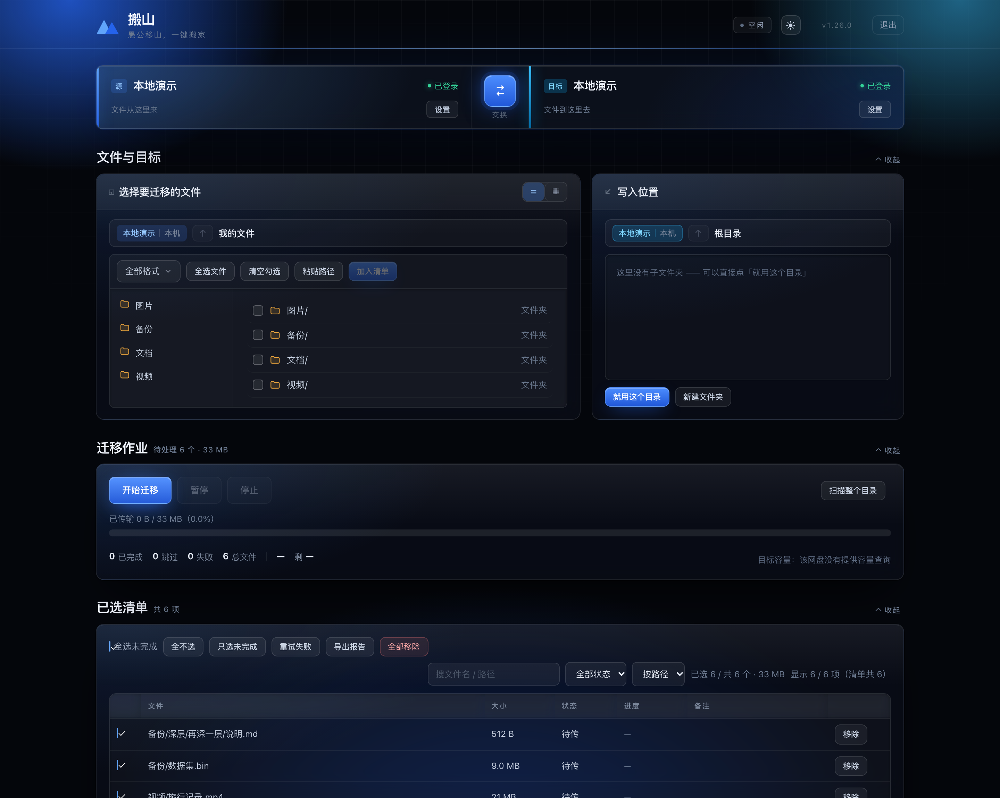

# 搬山 · 网盘迁移工具

把文件从一个网盘搬到另一个网盘。**本机中转，不落整盘，断了能续。**

双击启动，浏览器自动打开界面：左边挑文件，右边选去向，点「开始迁移」。
不需要装运行时、不需要注册账号、不经过任何第三方服务器。



<sub>浅色 / 深色两套皮肤，跟着系统偏好走，右上角可手动切换；截图里是本地演示数据。</sub>



---

## 支持哪些网盘

六家网盘，**任意方向**（两端都能任选一个，随时互换）：

| 网盘 | 登录方式 | 读 | 写 |
|---|---|:--:|:--:|
| 百度网盘 | 扫码（网页登录态）/ 开放平台 OAuth / 手动 Cookie | ✓ | ✓ |
| 阿里云盘 | 扫码（网页令牌）/ 开放平台 | ✓ | ✓ |
| 夸克网盘 | 扫码 | ✓ | ✓ |
| 天翼云盘 | 一键登录（受控浏览器自动抓 Cookie） | ✓ | ✓ |
| 115 网盘 | 扫码 | ✓ | ✓ |
| 123 云盘 | 扫码 | ✓ | ✓ |

每个网盘的上传分片大小、并发上限、续传能力各不相同，工具按目标端能力自动收敛，不给跑不通的档位。

## 它是怎么做的

| 部分 | 做法 |
|---|---|
| 后端 | 纯 Python 标准库起本地 HTTP 服务，只监听 `127.0.0.1` |
| 前端 | 手写 HTML / CSS / JS，零框架，改完刷新即生效 |
| 传输 | 分片直传，读一块传一块，整文件不落本地磁盘；SQLite 记事，关掉再开能接着传 |
| 校验 | 传完比对大小 + 首/中/尾抽样内容，不一致即判失败 |
| 登录 | 受控浏览器 + Chrome DevTools Protocol（纯标准库手写 WebSocket），或 macOS 上的 WebDriver（Safari） |

**为什么不用全文件 SHA1 校验**：那要把源端再读一遍，流量翻倍。抽样能发现绝大多数静默损坏，代价小得多。

## 快速开始

### 用现成包

- **Windows**：下载 Release 里的 `搬山.exe`，双击即用
- **macOS**：下载 Release 里的 `搬山.app`（Apple Silicon），双击即用

首次打开若提示「无法验证开发者」：右键 → 打开；或到「系统设置 → 隐私与安全性」点「仍要打开」。
macOS 单文件版（`搬山`）需要先 `chmod +x` 再运行。

### 从源码跑

```bash
# Windows / macOS / Linux 都行，只要有 Python 3.9+
python3 -m panmigrate          # 默认 http://127.0.0.1:8899
python3 -m panmigrate --port 8901
```

界面里默认就是真机模式。想在没有账号的机器上先跑通链路：

```bash
curl -X POST http://127.0.0.1:8899/api/demo
```

它会把**还没登录凭据**的那一端切成「本地演示」，在 `data/demo/` 造几个演示文件，用两个本地文件夹模拟两端网盘。

### 数据放哪里

| 场景 | 位置 |
|---|---|
| Windows 打包版 | `%APPDATA%\panmigrate` |
| macOS 打包版 | `~/Library/Application Support/panmigrate` |
| 源码运行 | 项目内 `data/` |
| 便携模式 | 程序同级的 `panmigrate-data/` 文件夹（有就用它） |
| 强制指定 | 环境变量 `PANMIGRATE_HOME=/你的路径` |

账号凭据（Cookie / token）只写在本机这个目录里，**不上传任何服务器**。

### 网页登录用哪个浏览器

天翼一键登录、115 / 123 扫码登录需要拉起一个受控浏览器窗口：

- 默认用 Chrome 或 Edge（自动找）
- **macOS 上还可以用 Safari**：设置 → 高级设置 →「网页登录用哪个浏览器」选 Safari。
  首次需要授权：Safari → 设置 → 高级 → 勾选「显示网页开发者功能」，再到「开发」菜单勾「允许远程自动化」
  （或终端执行一次 `sudo safaridriver --enable`）。没授权时界面会直接告诉你怎么开。

## 打包

```bash
# macOS：出 dist/搬山（单文件）和 dist/搬山.app（双击启动、Dock 有图标）
bash build_mac.sh

# Windows：出 dist\搬山.exe
build_win.bat
```

Windows 打包前先 `pip install pyinstaller`。PyInstaller 不支持交叉打包——Mac 包只能在 Mac 上打，反之亦然。
打包务必先删 `build/` 和 `dist/`，否则可能复用缓存导致图标/静态资源不更新。

## 测试

```bash
python3 -m unittest discover -s tests -t .
# Ran 253 tests ... OK
```

`-t .` 不能省，否则相对导入会报错。用例覆盖传输引擎（分片、续传、速率、暂停）、四家以上适配器、登录态判定、
任务库、调度、HTTP 路由，以及 Safari/Chrome 两条浏览器通道的取凭据逻辑（全部离线，用假服务应答）。

## 目录结构

```
panmigrate/           后端
├─ server.py          HTTP 路由 + App 编排
├─ engine.py          传输引擎（分片 / 断点续传 / 校验 / 限速）
├─ adapters/          六个网盘适配器 + 本地演示
├─ qrlogin.py         扫码登录（百度 / 阿里 / 夸克）
├─ tylogin.py         天翼一键登录（CDP）
├─ web_login.py       115 / 123 扫码登录（CDP）
├─ safari.py          macOS Safari 通道（WebDriver）
├─ cdp.py             手写 CDP WebSocket 客户端
├─ db.py              任务库（SQLite）
└─ web/               前端（index.html / app.js / 三份样式表）
tests/                253 个单元测试
docs/                 打包、部署、架构、界面规范、macOS 适配说明
posters/              宣传图与源文件
vendor/               二维码库（内联，免 pip 安装）
```

## 已知限制

- 全部依赖各家网盘的**非公开接口**，平台一改就可能失效，属于可预期的维护成本
- 百度开放平台认证免费即时，但第三方应用只能拥有一个位于 `/apps/` 下的专属文件夹，读不到你网盘里已有的其它文件 —— 想迁移得先把文件挪进去，所以默认给的是扫码登录（能读全盘，代价是会过期）
- 115 写入是整文件上传，单文件上限 500MB
- 夸克、天翼的部分能力受账号等级影响
- 凭据在本地是明文（`config.json`），共用电脑请注意

## 免责声明

仅供迁移**你自己**的文件。请遵守各网盘的服务条款，不要用于传播侵权内容或规避平台限制。
因使用本工具造成的任何后果由使用者自行承担。

## 文档

- [使用说明（详细版）](docs/使用说明-详细版.md)
- [打包说明](docs/打包说明.md) ｜ [部署说明](docs/部署说明.md)
- [架构对标分析](docs/架构对标分析.md) ｜ [开源项目调研](docs/开源项目调研.md)
- [界面规范](docs/项目状态与界面规范.md) ｜ [macOS 适配与 Safari 登录](docs/macOS-适配与Safari登录.md)

## License

[MIT](LICENSE)
